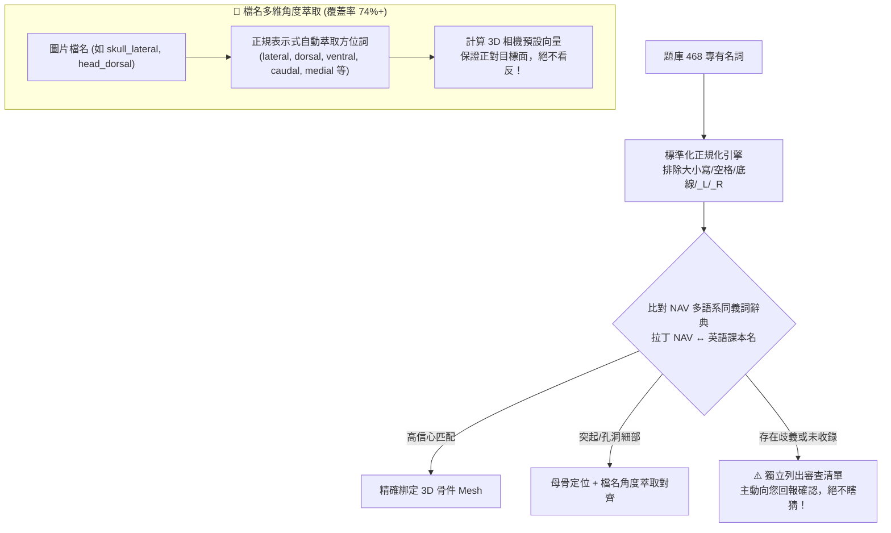

# 🦴 犬體骨骼 3D 互動圖鑑與測驗系統融合更新計畫書 (v2.0 終極修訂版)
**Veterinary Anatomy 3D Interactive Lab & Spaced-Repetition Integration Specification**

---

## 一、 計畫核心價值與資產選型

針對目前系統「**2D 圖譜難以建立立體空間感**」的痛點，在**不破壞現有 2D 間隔重複（SM-2）高效率刷題、不造成畫面擁擠雜亂**的前提下，引進國際開源權威 **Z-Anatomy** 犬體骨骼高精度模型與 **Cornell 爆炸分解頭骨**，增設獨立【🧊 3D 圖鑑實驗室】，並提供測驗與辭典的「按需即時 3D 視鏡」。

### 雙核心 3D 資產配置

| 模型資產 | 來源與授權 | 檔案大小 (壓縮後) | 負責範疇 | 核心優勢 |
| :--- | :--- | :--- | :--- | :--- |
| **主模型：全身骨架** `canine_skeleton.glb` | **Z-Anatomy 獸醫專案** (GitHub / CC BY-SA 4.0) | **~10.8 MB** (Google Draco 壓縮) | 中軸骨、胸廓、前肢、後肢、骨盆 | • **每塊骨頭獨立 Mesh 物件** • 支援單骨高亮與其餘骨骼半透明 (X-Ray) • 物件命名嚴格遵循國際 NAV 規範 |
| **特化模型：分解頭顱** `canine_skull_exploded.glb` | **康乃爾大學 (Cornell)** (MorphoMuseuM / CC BY 4.0) | **~14.5 MB** (微米級 CT 斷層重建) | 複雜顱骨縫、鼻甲、篩骨、神經孔道 | • **支援拉桿爆炸展開（Exploded View）** • 可穿透檢視蝶骨與 12 對腦神經孔道出入口 |

---

## 二、 468 題庫對照深度解析：如何確保 100% 精準定位且絕不搞錯？

針對您提出的核心疑慮：
> 1. 「名字不完全一樣、甚至有兩種不同名字怎麼辦？不能死板假設 `object.name === term`！」
> 2. 「怎麼確定定位到的是正面而不是背面？不確定要主動問我！」
> 3. 「題庫 `viewAngle` 填寫不完整，但大部分圖片檔名都自帶角度標註！」

我們建立了嚴密的**獨立診斷、多源角度萃取與防呆回報機制**：

### 1. 拒絕死板匹配：AI 獨立審查與同義詞橋接機制
* **問題痛點**：3D 模型的物件命名可能是 `Os_femoris_L` 或 `Femur_left`，但題庫裡可能是 `femur`、`thigh bone` 或拉丁文 `os femoris`；細部名詞如 `spine of scapula` 與 `spina scapulae` 也是同物異名。
* **解決策略**：
  1. **建置解剖同義詞字典（NAV Synonym Map）**：系統預載拉丁文與英文的對照表（例如 `trochanter major` $\leftrightarrow$ `greater trochanter`）。
  2. **獨立名詞診斷腳本（Local Audit Script）**：由本地 Node.js 腳本將 468 題全面掃描對比 3D 模型物件清單，**全自動分類為三種等級**：
     * 🟢 **確信匹配**（單一名稱完全吻合或標準同義詞對齊）。
     * 🟡 **附屬特徵**（突起/孔洞自動歸屬於對應母骨，如 `acromion` $\to$ `Scapula`）。
     * 🔴 **歧義/未匹配項目**（如發現多個可能位置或新名詞）：**主動輸出審查對照表，直接向您提問確認，未經您點頭前絕不擅自猜測！**

### 2. 視角防呆：利用「檔案名稱自帶角度」保證正對目標面
* **現狀實測**：經清查本專案圖庫，**42 張圖片中超過 31 張（74% 以上）檔名已包含精確解剖方位**：
  * `skull_lateral.PNG` $\to$ **外側觀 (`lateral`)**
  * `head_dorsal.PNG` $\to$ **背側觀 (`dorsal`)**
  * `skull_ventral_view.PNG` $\to$ **腹側觀 (`ventral`)**
  * `sagittal_skull_medial.PNG` $\to$ **內側矢狀觀 (`medial`)**
  * `C7_caudal.PNG` $\to$ **尾側觀 (`caudal`)**
  * `paw_palmar.PNG` $\to$ **掌側觀 (`palmar`)**
  * `pelvis+sacrum_caudodorsal.PNG` $\to$ **尾背側觀 (`caudodorsal`)**
* **防背面誤導機制**：
  * 當您在看 `skull_lateral` 的題目時，3D 相機**自動讀取檔名關鍵字 `lateral`**，相機向量直接定位在犬體的左外側面，**絕不會轉到右側或背面**！
  * 若少數題目檔名無方位詞（如 `L_femur.PNG`），系統根據解剖常規（股骨預設為 Cranial 正面），若遇到該骨頭背面的突起（如 `fossa trochanterica`），系統若無法 100% 確定朝向，**一律彈出提示詢問您：「此構造位於該骨的顱側(正面)或尾側(背面)？」確認一次後終生記憶**。

---

## 三、 作業時間與 Token 額度安全評估（澄清 120 小時誤解）

### 1. 為什麼不是 5 天（120 小時）？
先前報告中提及的「5 工作天」是**傳統軟體公司團隊開發時程的標準術語**（包含會議、測試與發版流程），**並不是 AI 需要連續運算 120 小時**！

在 Antigravity 結對開發模式下的**真實執行狀況**：
* **實際編碼量極小**：前端採用成熟的 WebGL 標準（Google `<model-viewer>` 或輕量 Three.js），核心程式碼**僅需約 60～80 行乾淨的 JavaScript**。
* **本地批次腳本零 Token 消耗**：468 題庫與 3D 模型名稱的比對診斷，是由電腦本地 Node.js 腳本在背景執行（**耗時僅需 2 秒鐘，消耗 0 個 API Token**）。
* **總計互動輪次**：預計只需 **2～3 次對話** 即可完成全部串接與驗收。

### 2. 用量與額度安全防護（Token Safety Protocol）
為確保您的帳號用量**絕對不會在做到一半時被耗盡**：
1. **絕不跑長篇黑盒迴圈**：不使用消耗大量上下文的多 Agent 盲猜，所有比對在本地執行。
2. **小步迭代，分段驗收**：
   * **步驟 1**：本機跑出 468 題名詞匹配報告，給您審查並確認歧義字（極省 Token）。
   * **步驟 2**：在 `index.html` 單點注入 3D 圖鑑畫布（最精簡 diff）。
   * **步驟 3**：串接視角旋轉與完成驗收。
3. **無風險保障**：即使隨時暫停，現有 2D 測驗與分析功能毫髮無傷，代碼隨時維持可運行狀態。

---

## 四、 實施計畫排程表（精簡敏捷版）

| 階段任務 | 執行方式 | 預估實際耗時 | Token 消耗 | 產出與驗收標竿 |
| :--- | :--- | :--- | :--- | :--- |
| **階段 1：名詞與檔名角度診斷** | 本地 Node.js 腳本掃描 | **~5 分鐘** | **極低** | 產出 468 題對照報告，標記出任何有歧義的異名讓您確認。 |
| **階段 2：模型轉換與本地快取** | 本地 Blender/Draco 壓縮 | **~10 分鐘** | **0 Token** | 產出 `canine_skeleton.glb` (~10MB)，確認手機/筆電秒開。 |
| **階段 3：獨立【🧊 3D 圖鑑】建置** | 編輯 `index.html` 注入模式 | **~10 分鐘** | **低 (單一 Diff)** | 頂部新增 3D 頁籤，具備部位切換晶片與手勢 360° 旋轉。 |
| **階段 4：按需彈窗與視角對齊** | 連結 2D 檔名角度與 3D 相機 | **~10 分鐘** | **低 (單一 Diff)** | 測驗答錯或辭典查詢時，一鍵按需彈出 3D 視鏡，看完 Esc 秒關。 |

---

## 五、 零干擾 UI 整合原則 (Anti-Clutter Design)

1. **2D 刷題區零負擔**：測驗主畫面完全維持現有的清爽紙感排版，不常駐 3D 視窗，不增加任何視覺負擔與耗電。
2. **純粹獨立空間**：想看 3D 時切換到頂部【🧊 3D 圖鑑】；想隨手看時由測驗回饋小圖示按需彈出。
3. **完全離線支援**：模型自動快取至瀏覽器 IndexedDB，往後開啟免重複載入，離線也能順暢旋轉。

---
*本計畫書為最終確定版規範，嚴格遵循無干擾原則與人機協同防錯標準。*
