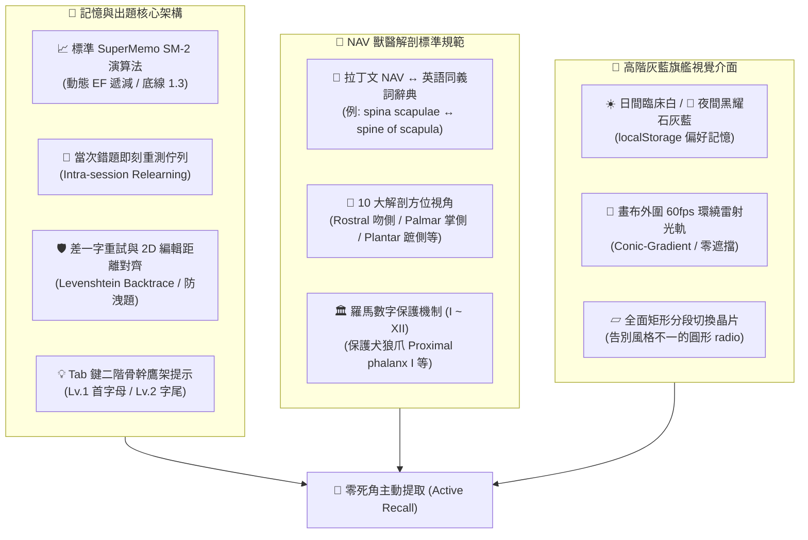

# 🦴 獸醫解剖學專業圖鑑與記憶分析系統
### Veterinary Anatomy Mastery & Spaced Repetition System (V9-PRO Flagship Edition)

[](LICENSE)
[](#-nav-解剖命名與同義詞標準)
[](#-真正的-supermemo-sm-2-記憶週期引擎)
[](#-俐落高階灰藍旗艦視覺介面)
[](#-快速開始與部署)

一套專為獸醫學系學生、獸醫師與解剖學研究者打造的**高階犬體骨骼解剖圖鑑標註、測驗與間隔重複（Spaced Repetition）記憶分析系統**。

嚴格依循國際獸醫解剖命名權威規範 **《Nomina Anatomica Veterinaria (NAV)》** 與權威圖譜 **《Miller's Guide to the Dissection of the Dog (8th Ed.)》**，整合了真實 SM-2 遺忘曲線演算法、本機端 AI-OCR 智慧辨識引擎、全圖地毯巡航模考以及高階深淺灰藍旗艦視覺介面。

---

## 🌟 核心特色與六大架構支柱



---

### 1. 📈 真正的 SuperMemo SM-2 記憶週期引擎
系統杜絕市面上隨意寫死加減間隔的「偽記憶演算法」，嚴格遵循 Piotr Woźniak 官方提出的 SM-2 數學模型：

$$\text{Grade} \in \{0, 1, 2, 3, 4, 5\}$$
$$EF' = \max\left(1.3,\; EF + (0.1 - (5 - \text{Grade}) \cdot (0.08 + (5 - \text{Grade}) \cdot 0.02))\right)$$

$$I(n) = \begin{cases} 1 & n = 1 \\ 6 & n = 2 \\ \text{round}(I(n-1) \cdot EF) & n > 2 \end{cases} \quad (\text{若 Grade } \ge 3)$$

* **提取品質評級階梯**：
  * **Grade 5（完美提取）**：零提示、零重試、精確拼出正確名詞。
  * **Grade 4（良好記憶）**：使用 `Lv.1` 首字母提示、或命中 NAV 拉丁文同義詞、或輕微筆誤容錯通過。
  * **Grade 3（及格邊緣）**：使用 `Lv.2` 骨幹提示、或觸發「🛡️ 差一字重試」後才拼對（強制調降 $EF$，縮短下次複習間隔）。
  * **Grade 1（記憶中斷）**：答錯時立刻歸零間隔 ($I=1$)，並自動推進**當次即刻重測佇列（Intra-session Relearning Queue）**，在後續 3~4 題內強制回考強化突觸。

---

### 2. 🛡️ 差一字重試保連勝（Near-Miss Retry）與 2D 動態規劃對齊
* **防洩題認知防護**：
  在填空題中，若輸入拼字與答案僅差 1~2 個字母，系統會在不中斷連勝（🔥 COMBO）的前提下提供一次重試機會。
  在重試診斷中，系統**絕不公佈正解字母**，而是顯示學生自己的輸入：
  * 綠字：拼對字母
  * 紅字：拼錯字母
  * 紅底 `_`：漏打位置
  * 刪除線：多打字母
* **2D 編輯距離序列回溯（Backtrace Alignment）**：
  徹底解決傳統絕對索引比對在「開頭漏打 1 字，後面整串全標紅」的誤導問題。

---

### 3. 📖 NAV 解剖命名規範與羅馬數字保護
* **雙向同義詞字典**：
  深度內建常見犬體骨骼名詞（如 `trochlea humeri` $\leftrightarrow$ `trochlea of humerus`、`foramen magnum` $\leftrightarrow$ `great foramen`、`mammillary process` $\leftrightarrow$ `mamillary process` $\leftrightarrow$ `processus mamillaris` 等）。
* **犬體方位專用選單**：
  支援頭部專用吻側觀（`Rostral`）、四肢前掌側觀（`Palmar`）、後蹠側觀（`Plantar`）、顱側觀（`Cranial`）、尾側觀（`Caudal`）等 10 大 NAV 標準解剖視角。
* **解剖羅馬數字保護**：
  本地端 AI-OCR 智慧清洗管線（`Tesseract.js`）全面保護羅馬數字編號（$I \sim XII$），徹底杜絕犬第一指（狼爪，Dewclaw / Pollex）之 `Proximal phalanx I` 字尾 `I` 被誤認為圖片雜訊削去的痛點。

---

### 4. 🗺️ 全圖地毯式模考（Full-Sheet Spatial Mode）
* **空間幾何排序**：
  系統依據遮罩幾何中心座標，支援 **35px 水平分帶由上而下、由左而右** 或 **極座標順時針（Clockwise via $atan2$）** 環繞出題。
* **漸進透視解鎖**：
  在整張圖譜上保持全黑遮蓋，隨著答題逐一將紅色考題翻牌解開，直到全圖構造融會貫通。

---

### 5. 🎨 俐落高階灰藍旗艦視覺介面
* **日夜雙模式**：
  * 🌙 **夜間黑耀石灰藍（Obsidian Slate-Blue）**：底層 `#0b0f19`，卡片 `#151e2e`，天藍亮點 `#38bdf8`。長時間刷題眼壓極低。
  * ☀️ **日間臨床白（Medical Slate-White）**：底層 `#f8fafc`，純白卡片搭配醫學湛藍 `#0284c7`。
  * 偏好設定自動持久化於 `localStorage`。
* **60fps 環繞雷射光軌**：
  主畫布外圍配置平滑旋轉之無斷點環形霓虹光軌（`@property --beam-angle`），鎖定 `pointer-events: none;`，零干擾繪圖操作。
* **全面矩形晶片化**：
  淘汰傳統圓形 radio 按鈕，統一採用圓角矩形分段切換晶片（Rectangular Segment Chips）。

---

### 6. 💾 零摩擦本地持久化與圖庫自動快取
* **內建 39 張高解析犬體骨骼圖譜**：
  儲存於 `images/` 目錄。初次開啟網頁，系統自動透過背景協程快取至瀏覽器內建 **IndexedDB (`AnatomyImageStore`)**，往後開啟免重新選取檔案。
* **Firestore 階梯化 3 層架構**：
  `categories/{cat}/images/{img}/terms/{id}`，並搭載批次分塊寫入安全防禦（`BATCH_SIZE = 100`），絕不觸發 Firestore 500 次寫入上限。

---

## 📂 專案檔案結構

```text
anatomy-quiz/
├── index.html                   # 生產級單一自包含應用程式 (HTML5 / CSS3 / ES Module)
├── images/                      # 39 張高解析度犬體骨骼圖譜 (PNG/png)
│   ├── atlas_dorsal(C1).png
│   ├── axis_left_lateral (C2).png
│   ├── L_femur.PNG
│   ├── paw_palmar.PNG
│   ├── sacrum_dorsal.PNG
│   └── ... (共 39 張解剖圖)
├── CODE_REVIEW_*.md             # 歷次代碼審查、獸醫學博士驗收報告與修復對照矩陣
├── .gitignore                   # 安全略過 103.5MB 教科書 PDF 與暫存檔
├── README.md                    # 本專案完整技術與規格說明文件
└── LICENSE                      # MIT 授權條款
```

---

## 🚀 快速開始與部署

### 1. 本地直接執行
1. 下載或複製本專案至本機：
   ```bash
   git clone https://github.com/AAAaron-pro/anatomy-quiz.git
   cd anatomy-quiz
   ```
2. 直接雙擊 `index.html`，或使用任何本機靜態伺服器啟動：
   ```bash
   # 使用 Python 內建伺服器 (推薦)
   python -m http.server 8000
   
   # 或使用 Node.js
   npx serve .
   ```
3. 在瀏覽器打開 `http://localhost:8000`，點擊 **「🌐 使用 Google 登入」** 即可連線雲端題庫！

### 2. 部署至 GitHub Pages
1. 進入本 GitHub 儲存庫的 **Settings** $\rightarrow$ **Pages**。
2. 在 **Branch** 選項中選取 `main`，資料夾選取 `/ (root)`，點擊 **Save**。
3. 數十秒後即可獲得專屬線上圖鑑系統網址（例如：`https://aaaaron-pro.github.io/anatomy-quiz/`），手機、平板與電腦全平台通用！

---

## 📜 授權條款 (License)

本專案採用 [MIT License](LICENSE) 開源授權。解剖學圖譜與參考教材僅供獸醫學術交流、教學與個人研習使用。
