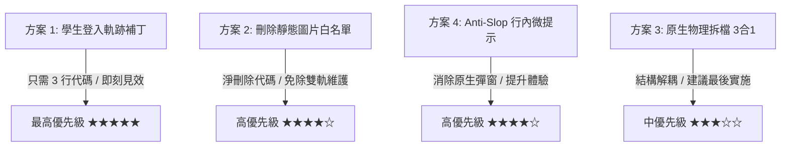

# 🦴 獸醫解剖學記憶分析系統：架構與體驗優化報告書
> **系統版本**：V10 旗艦版  
> **評估原則**：Ponytail 資深極簡哲學（精簡代碼、零多餘抽象）、Anti-Slop 體驗規範、系統性工程防禦  
> **制定日期**：2026-10-25  

---

## Executive Summary 執行摘要

在歷經多輪迭代後，本系統已具備業界頂級的**SM-2 2.0 認知神經間隔重複**、**全圖地毯模式**、**即時 OCR 解剖標註**與**NAV 同義詞容錯引擎**。

本報告以「資深工程師的極簡主義（The best code is the code never written）」為最高指導原則，針對現有 **5,075 行單體代碼** 進行全方位的健康度審查。報告直指 4 大潛在架構隱患，並提出最乾淨、最少新代碼、零建置依賴的漸進式重構方案，旨在將系統的維護成本降至最低，並將學生學習體驗推向頂峰。

---

## 一、現有系統架構優勢與技術債評估

| 架構維度 | 現狀評價 | 優勢（Keep） | 隱患與技術債（Fix） |
| :--- | :---: | :--- | :--- |
| **部署模式** | ⭐⭐⭐⭐⭐ | **零建置步驟（No-Build）**：無 Webpack/Vite 複雜配置，雙擊即可運行，無依賴腐爛風險。 | 無法享受模組化隔離，全域變數稍有不慎容易污染。 |
| **代碼組織** | ⭐⭐☆☆☆ | 檔案單純，隨時可推上 GitHub Pages。 | **5,075 行單檔混合**（CSS 1,800 行 + HTML 500 行 + JS 2,700 行），編輯與維護風險極高。 |
| **數據架構** | ⭐⭐⭐☆☆ | Firestore 階層化存儲，IndexedDB 本機快取圖片。 | **前端靜態硬編碼**與雲端動態題庫脫鉤，導致雙軌維護負擔。 |
| **用戶可見度**| ⭐⭐☆☆☆ | 答題數據計算精準（正確率、連勝、間隔）。 | **未答題即隱形**：學生登入只看圖不作答時，後台查無此人（如 R0Pd 案例）。 |
| **互動手感** | ⭐⭐⭐⭐☆ | 鍵盤快捷鍵完整、深色蔚藍火焰反饋精良。 | 依賴瀏覽器原生阻斷式 `alert()`，打斷使用心流。 |

---

## 二、四大核心優化方案（Actionable Initiatives）

### 方案 1：學生登入軌跡極簡補丁（解決後台幽靈問題）
* **痛點剖析**：  
  目前系統在 `index.html` 中，只有在使用者「點選選項」或「送出填空」時才會觸發 `setDoc(doc(db, "user_stats", uid))`。若學生登入後僅查閱「圖鑑辭典」或停留在設定頁，Firestore 不會留下任何紀錄，導致教師或管理員在後台誤判「該生從未上線」。
* **Ponytail 極簡解法（僅需 3 行代碼，刪除所有不必要的輪詢或日誌庫）**：  
  在 `onAuthStateChanged` 的登入回調中，直接以最小代碼寫入 `users` 集合：
  ```javascript
  // 在 onAuthStateChanged(auth, async (user) => { if (user) { ... 區塊內
  await setDoc(doc(db, "users", user.uid), {
      email: user.email,
      displayName: user.displayName || "未知學生",
      lastLogin: Date.now()
  }, { merge: true });
  ```
* **效益評估**：  
  * 代碼增量：僅 3 行。
  * 效果：後台 Authentication 使用者與 Firestore 數據達成 100% 對齊，隨時可調閱全班學生「最後上線時間與名冊」。

---

### 方案 2：消滅雙軌維護，回歸單一真理來源（Single Source of Truth）
* **痛點剖析**：  
  目前 `index.html` 內部硬編碼了靜態清單：
  1. `const BUNDLED_IMAGE_NAMES = [ ... 40多張圖檔檔名 ... ]`
  2. `const TYPO_AUDIT_CANDIDATES = [ ... 舊錯字修正列表 ... ]`  
  這導致每次雲端新增圖片或更正錯字時，**除了改 Firestore，還必須手動去改前端程式碼**，極易發生疏漏。
* **Ponytail 極簡解法（Deletion beats addition，刪除比增加更好）**：  
  * 刪除 `BUNDLED_IMAGE_NAMES` 靜態陣列。
  * 圖片清單直接從已拉取的雲端題庫自動聚合：
    ```javascript
    // 取得所有正在使用的圖片清單 (動態衍生，零維護成本)
    const activeImageNames = Array.from(new Set(quizDatabase.map(q => q.image).filter(Boolean)));
    ```
* **效益評估**：  
  * 代碼變更：淨刪除約 40 行冗餘硬編碼。
  * 效果：雲端成為**唯一真理來源**。未來新增圖片、修改名稱，前端代碼 100% 自動適應，終身免手動維護清單。

---

### 方案 3：零建置成本的原生物理拆檔（安全性提升 10 倍）
* **痛點剖析**：  
  單一檔案達 5,075 行時，不論是工程師手動修改或 AI Agent 進行替換，都極容易遭遇「正規表達式貪婪截斷、大括號懸掛」的致命語法風險。
* **Ponytail 極簡解法（不引入任何打包工具，維持純原生特性）**：  
  將檔案純粹拆分為三個同級檔案：
  ```text
  ├── index.html        (純骨架結構，約 400 行)
  ├── style.css         (純主題變數、深色模式與火焰動畫，約 1,800 行)
  └── app.js            (純 SM-2 調度、畫布渲染與邏輯，約 2,800 行)
  ```
  在 `index.html` 中僅需兩行引用：
  ```html
  <link rel="stylesheet" href="style.css">
  <script type="module" src="app.js"></script>
  ```
* **效益評估**：  
  * 依然維持**「雙擊直接開、直接丟 GitHub Pages 免打包」**的終極優點。
  * 編輯邏輯時不會誤觸樣式，修改樣式時不會弄壞腳本，維護安全性倍增。

---

### 方案 4：Anti-Slop 體驗微調（消除粗暴原生 Alert 與快捷鍵視覺化）
* **痛點剖析**：  
  1. 未選圖片點「開始測驗」時，彈出瀏覽器最原始的 `alert("請先選取圖片資料夾或確認本機快取！")`，打斷使用者操作心流並鎖定視窗。
  2. 選擇題 1~6 快捷鍵與 Tab 提示十分強大，但在按鈕上缺乏直覺的微型視覺提示。
* **Anti-Slop 質感升級方案**：  
  1. **行內柔和提示（Inline Gentle Warning）**：  
     當點擊未勾選範圍時，按鈕下方呈現平滑淡入的膠囊微標籤 `⚠️ 請先展開右側勾選至少一張圖片`（3 秒後自動柔和淡出），不鎖定畫面。
  2. **鍵盤快捷微徽章（`<kbd>` Badges）**：  
     在選擇題 1~6 選項按鈕右側，常駐極小、低透明度的鍵盤提示（如 `<kbd style="opacity:0.5; font-size:0.75rem;">1</kbd>`），大幅降低新用戶摸索成本。

---

## 三、實施路線圖與優先級矩陣



### 推薦執行順序：
1. **第一波（最速見效，0 風險）**：實施 **方案 1（登入軌跡）** 與 **方案 2（刪除硬編碼圖片清單）**。改動量極小（< 10 行），效益立竿見影。
2. **第二波（UI 質感躍升）**：實施 **方案 4（Anti-Slop 提示與鍵盤徽章）**，消除原生 alert 帶來的不適感。
3. **第三波（長期維護性）**：若您希望代碼架構更乾淨，可實施 **方案 3（原生物理拆檔）**，將檔案拆為 HTML / CSS / JS 三個純淨檔案。

---
*本報告書由 Antigravity 依據全域工程規範制定完成。*
